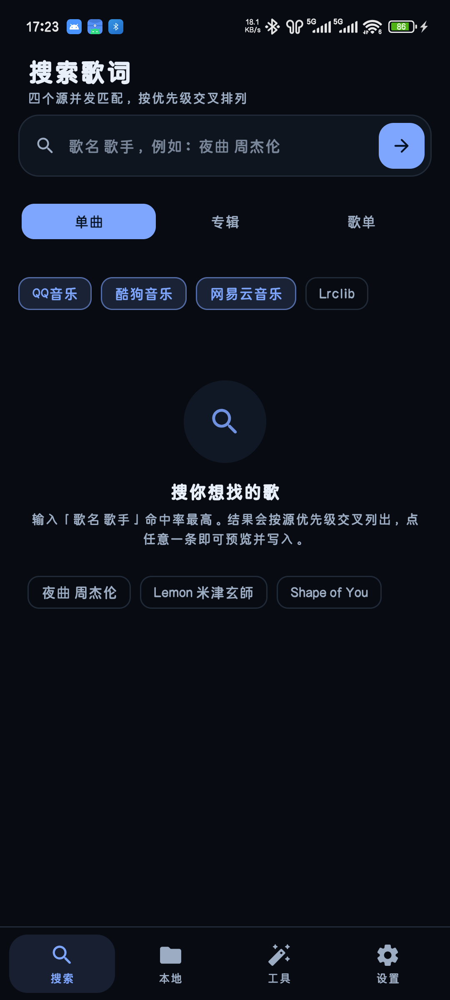
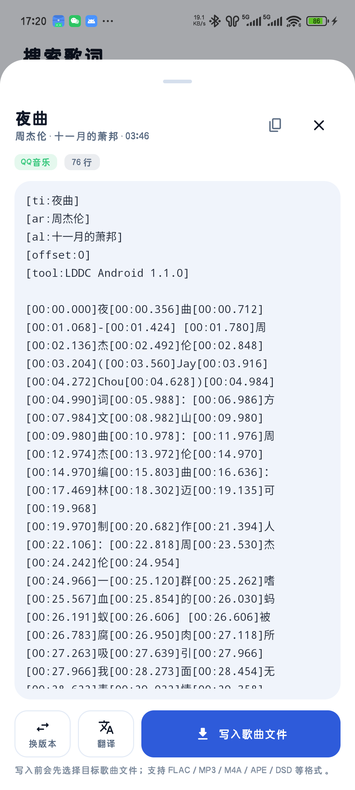
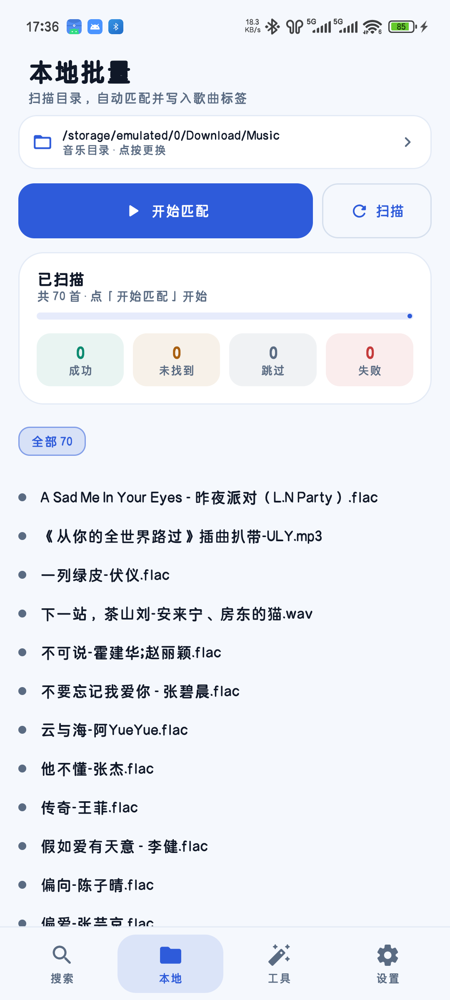
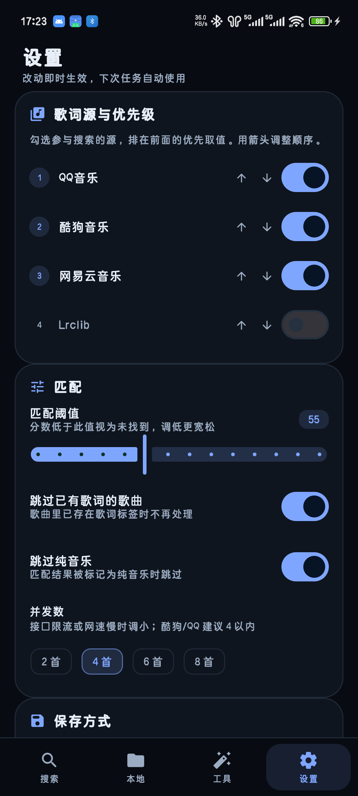

# LDDC Android

把 PC 端精准歌词工具 [LDDC](https://github.com/chenmozhijin/LDDC) 的完整链路搬上 Android：**搜索 → 自动匹配 → 写入歌曲标签 → 歌单下载**，格式覆盖与 PC 端对齐。

> 非官方移植，遵循 GPL-3.0-only 发布。上游作者：[沉默の金](https://github.com/chenmozhijin)。


-green)


<table>
  <tr>
    <td align="center"><br><sub>四源并发搜索</sub></td>
    <td align="center"><br><sub>逐字歌词预览</sub></td>
    <td align="center"><br><sub>本地批量匹配</sub></td>
    <td align="center"><br><sub>设置</sub></td>
  </tr>
</table>

## 功能

### 歌词源（四源并发）

| 源 | 搜索 | 歌词 | 逐字 |
|---|---|---|---|
| QQ 音乐 | 单曲 | QRC（3DES 解密后逐字） | ✅ |
| 酷狗音乐 | 单曲 / 专辑 / 歌单 | KRC（解密后逐字） | ✅ |
| 网易云音乐 | 单曲 / 专辑 / 歌单 | LRC | ❌ 游客态无逐字 |
| Lrclib | 单曲 | LRC | ❌ |

源的启用与优先级可在设置里拖动排序，搜索结果按优先级交叉排列；同一首歌有多个版本时可切换候选。

### 写入歌曲文件

基于 TagLib 2.3.2（NDK 交叉编译，仅 arm64-v8a）直接写文件标签，覆盖 PC 端支持的格式：

| 容器 | 标签 | 说明 |
|---|---|---|
| FLAC / OGG / Opus | Vorbis Comment `LYRICS` | 默认写逐行 LRC，可改为逐字或纯文本 |
| MP3 | ID3v2 `USLT` + `SYLT` | SYLT 带字级时间戳，逐字播放器可跟唱 |
| M4A / MP4 / M4B | iTunes atom `©lyr` | — |
| WAV / AIFF | ID3v2 / RIFF INFO | — |
| APE / WavPack | APEv2 | PC 端支持，jaudiotagger 不认，故选用 TagLib |
| DSF / DFF（DSD） | ID3v2 / DIIN | — |

保存形式三态：**仅标签 / 仅歌词文件 / 两者**，默认仅标签；可勾选「同时另存 .lrc」提升播放器兼容性。

### 本地批量

- 扫目录 → 逐首自动搜索 → 按评分匹配 → 写标签，全流程后台运行
- 匹配算法逐函数移植上游 `algorithm.py`，评分与 PC 版逐值一致（有 golden 基准守着）
- 前台服务 + 断点续跑：切后台、锁屏、乃至被系统杀掉后重开都能接着跑
- 「跳过已有歌词」「逐字歌词才跳过」「跳过纯音乐」三个开关控制重跑范围

### 工具箱与翻译

- 批量格式转换：LRC ↔ 逐字 LRC / 增强型 LRC / SRT / ASS，纯本地不联网
- 机器翻译：Bing / Google / OpenAI 兼容接口，给没有自带译文的歌补译
- 歌词语言组合：原文 / 译文 / 罗马音，顺序可调
- 路径占位符：`%<artist>` `%<title>` `%<album>` `%<id>` `%<langs>`

## 安装

从 [Releases](https://github.com/adaozi/LDDC-Android/releases) 下载 `LDDC-x.y.z-release-arm64.apk` 安装。

- 需要 Android 8.0（API 26）及以上，**仅 arm64-v8a**
- 首次使用需授予「所有文件访问权限」（`MANAGE_EXTERNAL_STORAGE`），用于扫描曲库与写回标签
- 调试包与正式包包名不同（`.debug` 后缀），可共存

## 构建

```bash
git clone --recursive https://github.com/adaozi/LDDC-Android.git
# 已 clone 过：git submodule update --init --recursive
```

环境要求：

| 组件 | 版本 |
|---|---|
| JDK | 17 |
| Android SDK | compileSdk 34 / targetSdk 34 / minSdk 26 |
| NDK | 27.1.12297006 |
| CMake | 3.22.1 |
| Gradle | 随 wrapper（AGP 8.5.2 / Kotlin 2.0.21） |

```bash
cd android
./gradlew assembleDebug     # 调试包
./gradlew assembleRelease   # 正式包，需签名配置
```

TagLib 是 git submodule（固定 2.3.2），首次构建会编译 C++ 部分，耗时 1–3 分钟。

### 发布签名

在 `android/keystore/keystore.properties` 写入：

```properties
storeFile=keystore/your-release.jks
storePassword=***
keyAlias=***
keyPassword=***
```

`keystore/` 已在 `.gitignore` 中。**注意自行备份**——丢失后无法为已安装用户提供升级包。

## 一致性验证

移植最怕「看着能跑，结果和原版不一样」，所以关键逻辑都对着上游做了逐值比对：

```bash
# 1) 解析/转换：上游 Python 生成基准，Kotlin 侧逐字节比对
python tools/golden/gen_golden.py
# 2) 匹配评分：同样由上游算出基准分数
python tools/golden/gen_match_scores.py
# 3) QRC 解密：用上游 tests/data 里真实的 QQ 加密文件
python tools/golden/gen_qrc_fixture.py

cd android && ./gradlew testDebugUnitTest
```

生成基准需要把上游源码放在 `upstream/`（未纳入本仓库，请自行 clone）。基准结果已提交在 `app/src/test/resources/`，只跑单测无需上游。

## 项目结构

```
android/app/src/main/
├── java/org/lddc/android/
│   ├── data/           # 四源接口、解密、解析、转换、标签读写、设置
│   ├── domain/         # 匹配算法、批量控制、保存、翻译、歌单下载
│   ├── service/        # 前台服务（批量任务常驻）
│   └── ui/             # Compose 页面：搜索 / 本地 / 工具 / 设置
├── cpp/                # TagLib JNI 桥（taglib 为 submodule）
└── resources/          # 网易云设备指纹池
tools/golden/           # 与上游对齐的基准生成脚本
PORTING_PLAN.md         # 移植方案与逐里程碑实施记录
```

## 已知限制

- **QQ 音乐**：已从 `musicu.fcg`（无登录态返回 `2001`）切到 web 接口 `search_for_qq_cp` + `lyric_download.fcg`。歌词接口要求**数字 songid**，传字母 songmid 拿不到内容。
- **网易云逐字**：游客登录只返回逐行 LRC，无 `yrc` 与翻译。
- **歌单 / 专辑下载**只产出 `.lrc` 文件，不修改任何音频（云端歌单本地无对应文件）。
- **仅 arm64-v8a**：32 位设备与模拟器不支持。
- 接口均为非官方公开接口，随时可能变更；失效请提 issue 并附日志（设置页「开发者 → 复制崩溃日志」）。

## 更新日志

见 [CHANGELOG.md](CHANGELOG.md)，移植过程的技术决策见 [PORTING_PLAN.md](PORTING_PLAN.md)。

## 许可

[GPL-3.0-only](LICENSE)。

本项目是 [chenmozhijin/LDDC](https://github.com/chenmozhijin/LDDC) 的衍生作品，复用了其算法设计、歌词解析规则与接口协议知识；QRC/3DES 与 KRC 解密为逐函数移植。据此同样以 GPL-3.0-only 开源分发。

QQ 音乐 web 接口用法参考：

- [ANYNC/TaskbarLyrics](https://github.com/ANYNC/TaskbarLyrics) —— 《QQ 音乐歌词获取文档》
- [luren-dc/QQMusicApi](https://github.com/luren-dc/QQMusicApi) —— Python SDK（Lyric API / QRC 解密）
- [xmcp/QRCD](https://github.com/xmcp/QRCD) —— QQ 音乐歌词爬取与解码
